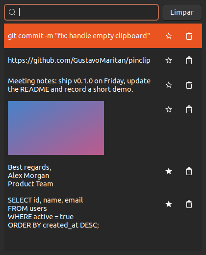

# Pinclip

A small clipboard history manager for Linux (X11), inspired by Windows' **Win+V**.
Press **Super+V**, pick something you copied earlier, and it gets pasted.

[Português](#português) · [License: MIT](LICENSE)

<p align="center"></p>

## Features

- Keeps **text and images** copied to the clipboard (the last 50 items).
- **Pinned items (★)** don't count toward the limit and are never removed automatically.
- Search as you type, navigate with ↑/↓, **Enter** or click pastes, **Delete** removes, **Esc** closes.
- Copying something again moves it back to the top.
- Skips content flagged by password managers (`x-kde-passwordManagerHint`, used by KeePassXC and others).
- A single Python file, no pip packages: only what a desktop distro already ships.

## Requirements

- **X11 session.** Wayland is not supported (clipboard monitoring and simulated Ctrl+V don't work there).
  On Ubuntu, pick "Ubuntu on Xorg" on the login screen.
- Python 3, PyGObject with GTK 3, and libXtst. Already installed on Ubuntu desktop. Otherwise:

  ```bash
  sudo apt install python3 python3-gi gir1.2-gtk-3.0 libxtst6   # Debian/Ubuntu
  sudo dnf install python3 python3-gobject gtk3 libXtst          # Fedora
  sudo pacman -S python python-gobject gtk3 libxtst              # Arch
  ```

## Install

```bash
curl -fsSL https://raw.githubusercontent.com/gustavomaritan/pinclip/main/install.sh | bash
```

Or clone the repository and run `./install.sh`. The installer:

- copies the app to `~/.local/bin/pinclip` (no root needed);
- starts it on login (`~/.config/autostart/pinclip.desktop`);
- on **GNOME**, binds **Super+V** (GNOME's notification tray stays on Super+M).
  On other desktops, create a keyboard shortcut that runs `~/.local/bin/pinclip`.

Run it again to update. To install a specific version: `PINCLIP_REF=v0.1.0` before `bash`.

## Uninstall

```bash
curl -fsSL https://raw.githubusercontent.com/gustavomaritan/pinclip/main/uninstall.sh | bash
```

Restores GNOME's original Super+V. Your history is kept in `~/.local/share/pinclip`; delete it by hand if you want.

## Privacy

Everything you copy is saved **unencrypted** in `~/.local/share/pinclip/history.json` (images as PNG files next to it),
except content marked by password managers. Use the **Clear** button ("Limpar") or delete the folder to wipe it.

## Limitations

- X11 only, as described above.
- In terminals, auto-paste doesn't work (they use Ctrl+Shift+V). The item is still placed on the clipboard.
- The interface is currently in Portuguese.

---

## Português

Gerenciador de histórico da área de transferência para Linux (X11), no estilo do **Win+V** do Windows.
Aperte **Super+V**, escolha algo que você copiou antes e ele é colado.

**Instalar:**

```bash
curl -fsSL https://raw.githubusercontent.com/gustavomaritan/pinclip/main/install.sh | bash
```

**Desinstalar:** o mesmo comando com `uninstall.sh`. O histórico fica em `~/.local/share/pinclip`.

- Guarda texto e imagem (50 itens). Os **favoritos (★)** não contam no limite e nunca são apagados automaticamente.
- Busca, ↑/↓, Enter ou clique cola, Delete remove, Esc fecha.
- **Só X11.** No Ubuntu, escolha "Ubuntu on Xorg" na tela de login.
- O atalho Super+V é configurado sozinho só no GNOME. Em outros desktops, crie um atalho para `~/.local/bin/pinclip`.
- **Privacidade:** tudo que é copiado fica salvo sem criptografia em disco, exceto o que vier marcado por
  gerenciadores de senha.
